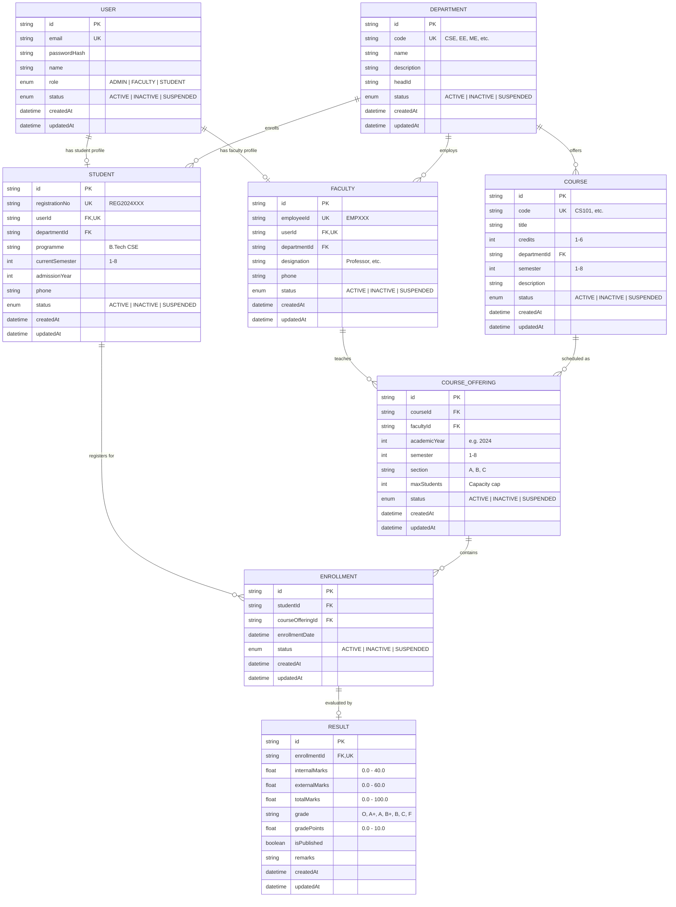

# Entity-Relationship (ER) Diagram & Database Architecture

## 1. Conceptual Entity-Relationship Diagram

---

## 2. Relational Schema & Constraints

### 1. `users` Table
- **Primary Key**: `id` (CUID text)
- **Unique Constraints**: `email`
- **Indexes**: `users_email_idx`, `users_role_idx`
- **Fields**: `id`, `email`, `passwordHash`, `role`, `name`, `status`, `createdAt`, `updatedAt`

### 2. `departments` Table
- **Primary Key**: `id` (CUID text)
- **Unique Constraints**: `code` (e.g. "CSE", "ECE")
- **Indexes**: `departments_code_idx`
- **Fields**: `id`, `code`, `name`, `description`, `headId`, `status`, `createdAt`, `updatedAt`

### 3. `students` Table
- **Primary Key**: `id` (CUID text)
- **Foreign Keys**: 
  - `userId` &rarr; `users.id` (ON DELETE CASCADE)
  - `departmentId` &rarr; `departments.id` (ON DELETE RESTRICT)
- **Unique Constraints**: `registrationNo`, `userId`
- **Indexes**: `students_registrationNo_idx`, `students_departmentId_idx`, `students_currentSemester_idx`

### 4. `faculty` Table
- **Primary Key**: `id` (CUID text)
- **Foreign Keys**:
  - `userId` &rarr; `users.id` (ON DELETE CASCADE)
  - `departmentId` &rarr; `departments.id` (ON DELETE RESTRICT)
- **Unique Constraints**: `employeeId`, `userId`
- **Indexes**: `faculty_employeeId_idx`, `faculty_departmentId_idx`

### 5. `courses` Table
- **Primary Key**: `id` (CUID text)
- **Foreign Keys**: `departmentId` &rarr; `departments.id` (ON DELETE RESTRICT)
- **Unique Constraints**: `code`
- **Indexes**: `courses_code_idx`, `courses_departmentId_idx`, `courses_semester_idx`

### 6. `course_offerings` Table
- **Primary Key**: `id` (CUID text)
- **Foreign Keys**:
  - `courseId` &rarr; `courses.id` (ON DELETE RESTRICT)
  - `facultyId` &rarr; `faculty.id` (ON DELETE RESTRICT)
- **Composite Unique Constraint**: `(courseId, academicYear, semester, section)`
- **Indexes**: `course_offerings_courseId_idx`, `course_offerings_facultyId_idx`, `course_offerings_academicYear_semester_idx`

### 7. `enrollments` Table (Resolves Many-to-Many between Student & CourseOffering)
- **Primary Key**: `id` (CUID text)
- **Foreign Keys**:
  - `studentId` &rarr; `students.id` (ON DELETE RESTRICT)
  - `courseOfferingId` &rarr; `course_offerings.id` (ON DELETE RESTRICT)
- **Composite Unique Constraint**: `(studentId, courseOfferingId)` &larr; **Guarantees no duplicate enrollments**
- **Indexes**: `enrollments_studentId_idx`, `enrollments_courseOfferingId_idx`

### 8. `results` Table
- **Primary Key**: `id` (CUID text)
- **Foreign Keys**: `enrollmentId` &rarr; `enrollments.id` (ON DELETE CASCADE)
- **Unique Constraints**: `enrollmentId` (One-to-One with Enrollment)
- **Indexes**: `results_enrollmentId_idx`, `results_isPublished_idx`

---

## 3. Database Normalization Analysis

### First Normal Form (1NF)
- All attributes contain only atomic (indivisible) values.
- No repeating groups or arrays stored in single columns.
- Each table has a defined Primary Key.

### Second Normal Form (2NF)
- The database is in 1NF.
- Every non-key attribute is fully functionally dependent on the primary key.
- Composite-keyed entities (such as `Enrollment`) have attributes that depend entirely on the primary identifier, with foreign keys linking to independent parent records.

### Third Normal Form (3NF)
- The database is in 2NF.
- There are no transitive dependencies: non-key attributes do not depend on other non-key attributes.
- Student department details (`Department`) are factored out of `Student` into `Department`.
- Course details are factored out into `Course`, and academic sessions are factored out into `CourseOffering`.
- User authentication details (`User`) are decoupled from domain entities (`Student`, `Faculty`), allowing single sign-on extensibility and zero redundancy.
